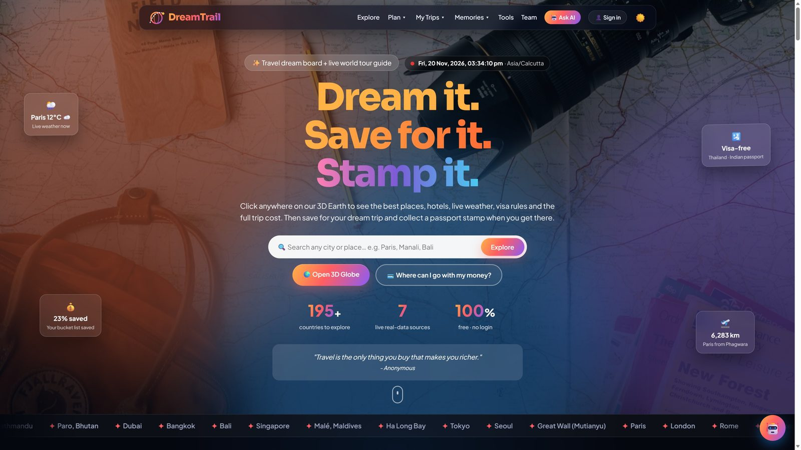
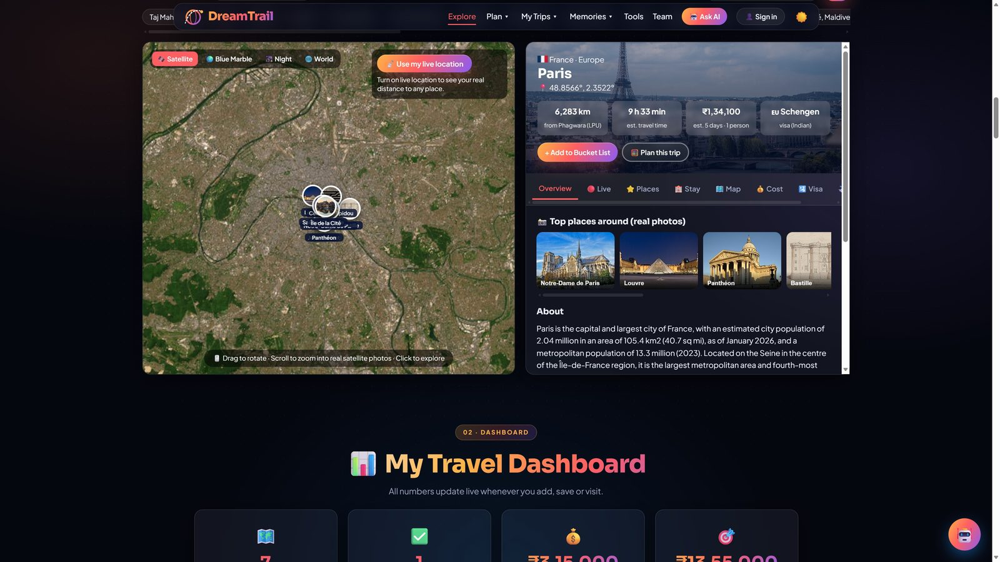
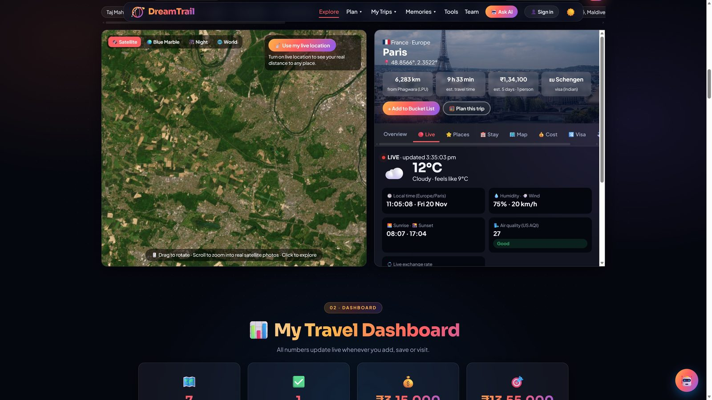
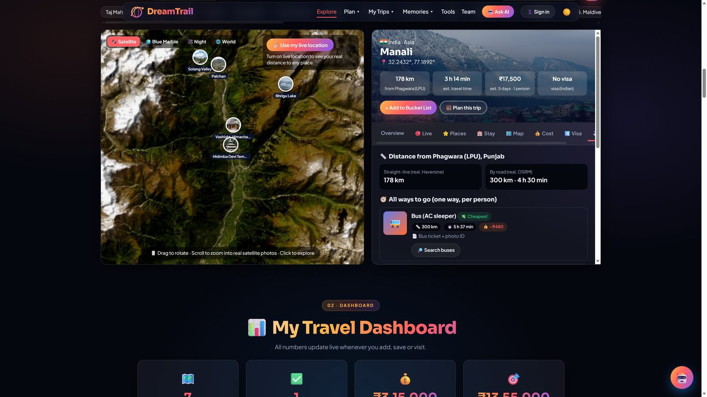
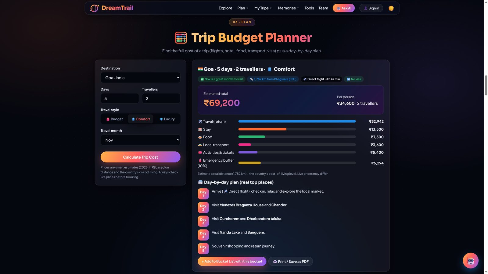
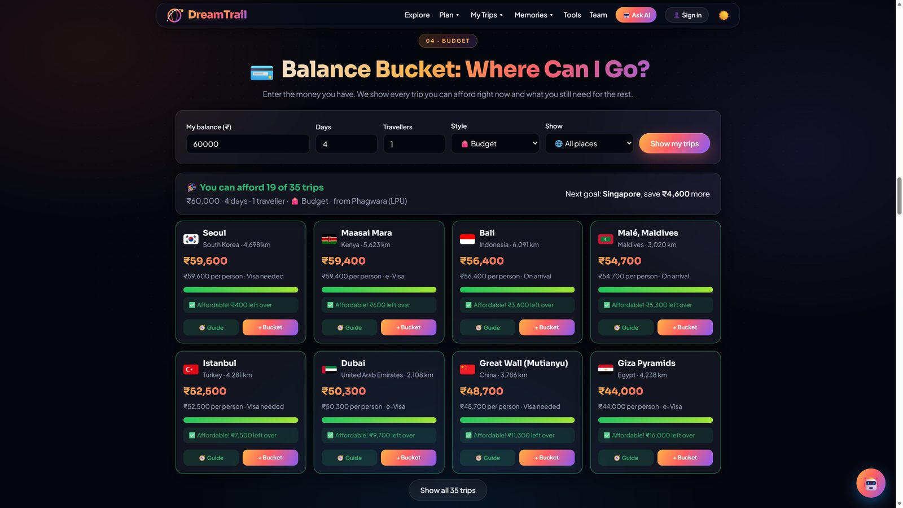
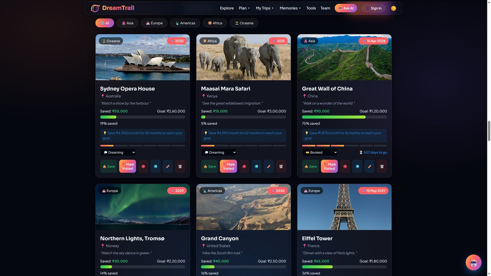
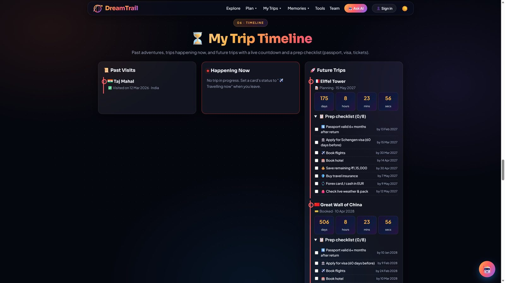
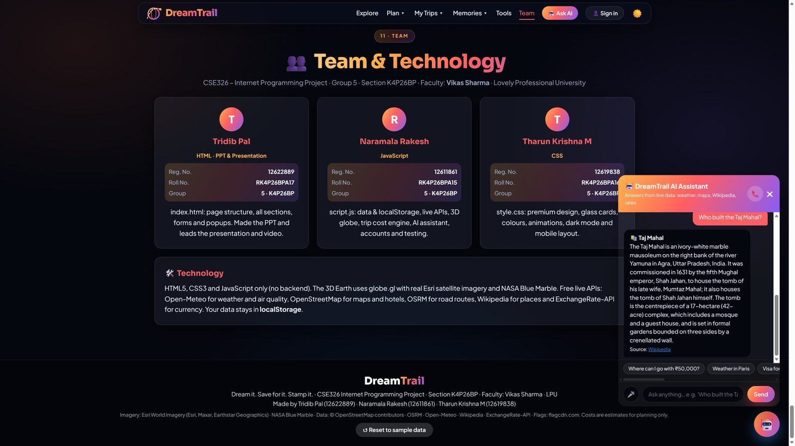

<div align="center">

# ✈️ DreamTrail

### Travel Bucket List & Global Dream Destination Milestone Tracking System

**Dream it. Save for it. Stamp it.**

[](https://dreamtrail-travel.vercel.app)
[](#-tech-stack)
[](#-tech-stack)
[](#-tech-stack)
[](LICENSE)

**CSE326 – Internet Programming Project · Group 5 · Section K4P26BP · Faculty: Vikas Sharma · Lovely Professional University**



</div>

---

## 📌 Problem Statement

> Travel enthusiasts dreaming of exploring global wonders (Taj Mahal, Eiffel Tower, Grand Canyon, Northern Lights,
> Great Wall of China) lack a **visual, motivating bucket list board** to track **dream destinations**, estimated
> **travel savings goals**, and **completed adventures**. The solution must be an interactive frontend without backend services.

## 💡 Our Solution

**DreamTrail** is a dream board and a live world tour guide in one responsive website. You can explore any place on a realistic
3D Earth and see real, live information about it. You can also plan the full trip cost, save money for each dream with a live countdown,
and collect a passport stamp when you visit.

### ✅ Required features (all implemented)

| Requirement | How DreamTrail does it |
|---|---|
| Dream destination card creator (name, country, target year, budget, photo URL) | Validated form + live photo preview; the place is found on the map automatically |
| Continent category filter (Asia, Europe, Americas, Africa, Oceania) | One-click filter chips + search, sort and status filters |
| Travel savings progress bar | Progress bar, "Add Savings" and a smart *"save ₹X per month"* plan |
| Interactive **"Visited!"** toggle with passport stamp badges | VISITED stamp, Passport page and a confetti celebration |

### 🚀 More features

- 🌍 **3D satellite Earth**: click **anywhere**; it flies down to street level and pins **real photos** of the top places
- 🔴 **Live data** for any place: weather, 5-day forecast, air quality, local time, exchange rate
- 🧭 **How to go**: flight, train, bus or car with **real road distance and time**, real airports and stations, and the documents needed
- 🛂 **Visa and passport steps** for Indian travellers, with official links
- 🏨 **Real hotels** (OpenStreetMap) with official star ratings
- 🧮 **Trip budget planner** with a day-by-day plan · 💳 **Balance Bucket** ("Where can I go with my money?")
- ⏳ **Live clock, countdown timers**, and a past/now/future **timeline** with a prep checklist
- 📡 **Live GPS**: shows where you are and your real distance to any place
- 🤖 **AI travel assistant**: answers from live data and Wikipedia, with 🎤 voice input and a 📞 voice call
- 👤 **Accounts** (SHA-256 hashed passwords), editable profile and photo, 📸 travel memories with photos, ⭐ reviews (estimate vs real cost)
- 🎒 Weather-based packing list · 💱 live currency converter · 📑 documents checklist
- ✨ Premium design: glassmorphism, 3D motion, Apple-style smooth scrolling, dark/light mode, fully responsive

## 🎬 Video, Presentation & Files

| | Link |
|---|---|
| 🎥 Video walkthrough (4K 60fps) | [Watch on Google Drive](https://drive.google.com/file/d/10_FAxwANWfH0ZF3CXeBaqo8ozrhXvSA1/view?usp=sharing) |
| 🎥 Video walkthrough (1080p) | [Watch on Google Drive](https://drive.google.com/file/d/1IcTBN6kKjMsFVgEEwtDPrnoYe0Z_J5ts/view?usp=sharing) |
| 📊 Presentation (PPTX) | [Open on Google Drive](https://drive.google.com/file/d/1xrFYQuIdddjFMSxltGlVDdyF0asqVG5u/view?usp=sharing) · also in [`docs/`](docs/) |
| 📁 All project files | [Google Drive folder](https://drive.google.com/drive/folders/1lIivImGBe8U5c5mBi8h1S74hxB3yPo9q?usp=sharing) |

## 🖼️ Screenshots

| 3D Explorer (real satellite + photo pins) | Live data |
|---|---|
|  |  |
| **How to go (real roads)** | **Trip budget planner** |
|  |  |
| **Balance Bucket** | **Bucket list** |
|  |  |
| **Timeline & countdown** | **AI assistant** |
|  |  |

## 🛠️ Tech Stack

| Layer | Technology |
|---|---|
| Structure | **HTML5** (`index.html`) |
| Design | **CSS3** (`style.css`): variables, Flexbox, Grid, keyframe animations, media queries |
| Logic | **JavaScript ES6** (`script.js`): DOM, events, `fetch`, async/await |
| 3D Earth | [globe.gl](https://github.com/vasturiano/globe.gl) (three.js / WebGL) |
| Smooth scroll | [Lenis](https://github.com/darkroomengineering/lenis) |
| Browser APIs | localStorage · Geolocation · Web Speech · Web Crypto (SHA-256) · Canvas |
| Hosting | **Vercel** (static hosting, global CDN, HTTPS) |

### 🌐 Live data sources (free, no API keys)

| Source | Used for |
|---|---|
| [Open-Meteo](https://open-meteo.com) | Weather, forecast, sunrise/sunset, air quality, local time |
| [OpenStreetMap Nominatim](https://nominatim.org) | Place search, reverse geocoding, hotels, airports, stations |
| [OSRM](https://project-osrm.org) | Real road distance & driving time |
| [Wikipedia](https://www.mediawiki.org/wiki/API:Main_page) | Nearby places, photos, popularity, answers |
| [ExchangeRate-API](https://www.exchangerate-api.com) | Live currency rates |
| [Esri World Imagery](https://www.arcgis.com/home/item.html?id=10df2279f9684e4a9f6a7f08febac2a9) | Satellite imagery |

> Only **trip costs are estimates**: real distance × each country's cost-of-living level. They are always labelled *"est."*,
> with links to live booking prices. Everything else is real, live data.

## 🏗️ Architecture

```
User action ─▶ Event listener ─▶ fetch() live APIs ─▶ update data (array of objects)
            ─▶ saveData() → localStorage (per user) ─▶ renderAll() redraws page + globe
```

- **Frontend only**: no backend server or database, as required by the problem statement.
- **Data storage**: the bucket list, accounts, memories and reviews are saved in the browser's **localStorage**, separately
  for each signed-in user. Passwords are stored as a salted **SHA-256** hash. Use **Backup / Restore** to move data between devices.

## 📁 Project Structure

```
├── index.html          # Page structure: sections, forms, popups
├── style.css           # Premium design, animations, responsive layout
├── script.js           # Data, live APIs, 3D globe, cost engine, AI assistant, accounts
├── vercel.json         # Hosting config
├── assets/screenshots/ # README images
└── docs/               # Presentation (PPTX) + presentation & video script (DOCX)
```

## ▶️ Run Locally

No installation needed: just open `index.html` in Chrome or Edge (it needs internet for live data).

```bash
git clone https://github.com/<your-username>/dreamtrail-travel-bucket-list.git
cd dreamtrail-travel-bucket-list
# open index.html in your browser
```

## 👥 Team: Group 5

| Member | Reg. No. | Roll No. | Contribution |
|---|---|---|---|
| **Tridib Pal** | 12622889 | RK4P26BPA17 | HTML (`index.html`) · PPT & presentation |
| **Naramala Rakesh** | 12611861 | RK4P26BPA15 | JavaScript (`script.js`) |
| **Tharun Krishna M** | 12619838 | RK4P26BPA16 | CSS (`style.css`) |

**Course:** CSE326 – Internet Programming · **Section:** K4P26BP · **Faculty:** Vikas Sharma · **Lovely Professional University**

## 📄 License

[MIT](LICENSE) © 2026 Group 5, DreamTrail. Map data © OpenStreetMap contributors · Imagery © Esri, Maxar, Earthstar Geographics.
